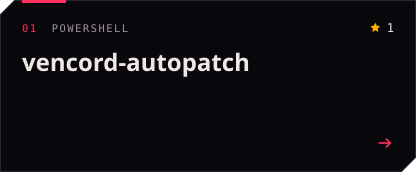
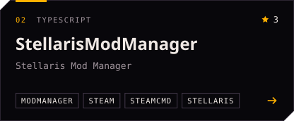
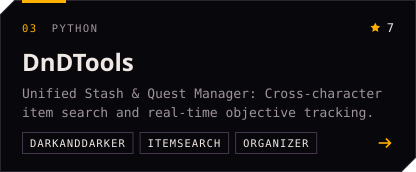
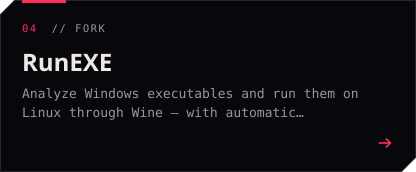
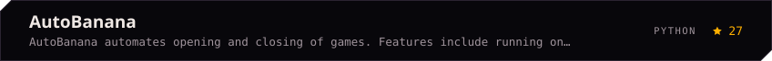
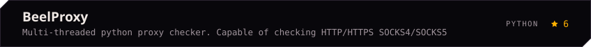
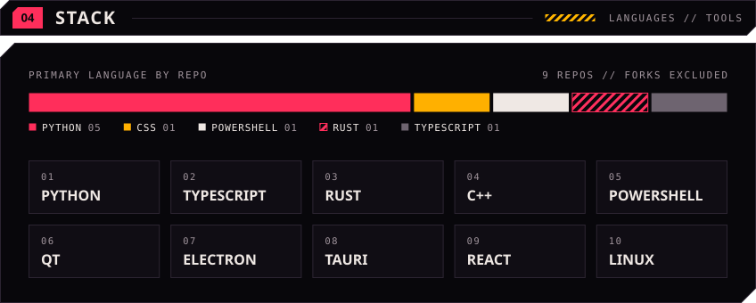
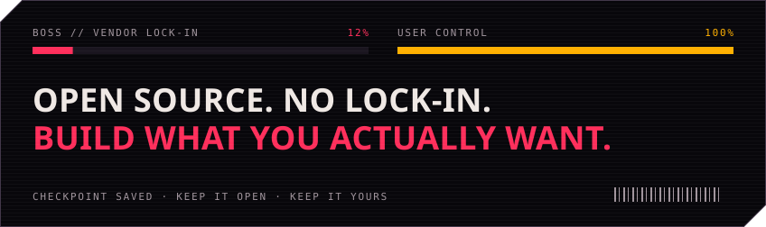

<!-- profile:start -->
<!-- Generated by scripts/build_profile.py. Edit profile.config.json, not this block. -->

  

  
  
  

  

  
  
  
  
  

  
  
  
  
  

  

  

<!-- profile:end -->
